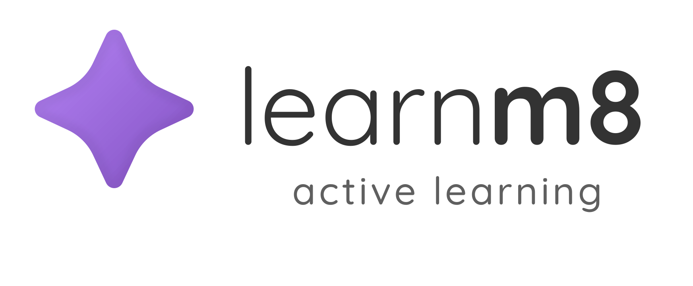
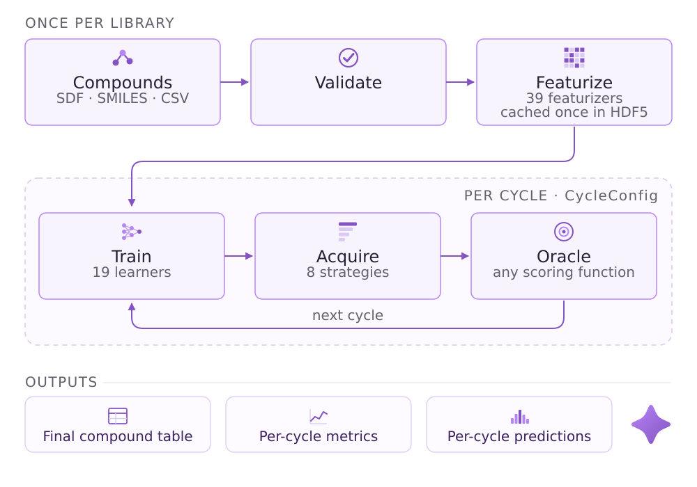

<div align="center">
  <picture>
    <source media="(prefers-color-scheme: dark)" srcset="https://raw.githubusercontent.com/drugm8/LearnM8/main/media/learnm8_white_full.png">
    
  </picture>
  <br><br>
  <strong>Active Learning Framework for Molecular Screening</strong>
  <br><br>

[](https://drugm8.github.io/LearnM8/)
[](https://www.python.org/downloads/)
[](https://github.com/drugm8/LearnM8/blob/main/LICENSE)

</div>

LearnM8 is a comprehensive active learning framework for molecular property prediction and compound screening. It combines state-of-the-art machine learning models with sophisticated acquisition strategies to enable efficient exploration of chemical space.

Built on a pure functional architecture, LearnM8 provides explicit cycle control, comprehensive uncertainty quantification, and molecular-specific optimizations. The framework supports both benchmark mode (a CSV oracle with known ground truth, for comparing learners and strategies) and run mode (a Python oracle that measures only the compounds you select, such as a docking run or an assay), so the same configuration can be tuned on a benchmark and then pointed at a real screen.

**Key Capabilities:** 19 learners (including Chemprop GNNs, ensembles, and CUDA-accelerated learners), 8 acquisition strategies, 39 featurizers (31 2D + 8 3D), a persistent HDF5 feature cache, automatic parallelization, GPU acceleration via GPyTorch and RAPIDS cuML, and design space pruning for large-scale screening.

## 🏗️ Architecture



A run is a loop: featurize the pool once into an HDF5 cache, train a learner on
what is labeled, predict over what is not, let an acquisition strategy pick the
next batch, measure it with an oracle, repeat. Cycle 0 is a random seed batch with
no model; cycles 1–N are the active learning proper.

## 📚 Documentation

**📖 [https://drugm8.github.io/LearnM8](https://drugm8.github.io/LearnM8/)**

- [Installation Guide](https://drugm8.github.io/LearnM8/getting-started/installation/)
- [Quickstart Tutorial](https://drugm8.github.io/LearnM8/getting-started/quickstart/)
- [Core Concepts](https://drugm8.github.io/LearnM8/getting-started/concepts/)
- [Lab Campaigns (slow assays)](https://drugm8.github.io/LearnM8/tutorials/lab-campaigns/)
- [CLI Reference](https://drugm8.github.io/LearnM8/user-guide/cli-reference/)
- [API Reference](https://drugm8.github.io/LearnM8/user-guide/api-reference/)
- [Learners](https://drugm8.github.io/LearnM8/components/learners/overview/) | [Acquisition](https://drugm8.github.io/LearnM8/components/acquisition/overview/) | [Featurizers](https://drugm8.github.io/LearnM8/components/featurizers/overview/)

## 🚀 Quick Start

### Installation

From PyPI:

```bash
pip install learnm8
pip install "learnm8[gpu]"  # adds GPyTorch and RAPIDS cuML for the GPU learners
```

For development, or to let conda manage the GPU stack, use the conda environment. It supplies every dependency, so install the package itself with `--no-deps` to keep pip from replacing conda-managed packages:

```bash
conda env create -f environment.yml
conda activate learnm8
pip install --no-deps -e .
```

### Your First Experiment

**Python API:**

```python
from learnm8 import run_active_learning

# oracle=None: the pool CSV doubles as the CSV oracle (benchmark mode)
results = run_active_learning(
    compound_pool='compounds.csv',
    oracle=None,
    learner='gp',
    target_col='Activity',
    featurizer='morgan',
    n_cycles=10
)

# Separate oracle CSV (its ID column must be named ID) and non-standard pool column names
results = run_active_learning(
    compound_pool='compounds.csv',
    oracle='oracle.csv',
    learner='gp',
    target_col='Activity',
    featurizer='morgan',
    n_cycles=10,
    smiles_column='Smiles',
    id_column='CompoundID'
)
```

**CLI Alternative:**

```bash
learnm8 validate compounds.csv
learnm8 run compounds.csv --target Activity --learner gp --featurizer morgan --n-cycles 10

# Non-standard column names
learnm8 run compounds.csv --target Activity --learner gp --featurizer morgan \
  --smiles-col Smiles --id-col CompoundID

# GPU + parallelism control
learnm8 run compounds.csv --target Activity --learner chemprop \
  --device cuda --n-jobs 8
```

## 📖 Examples

Learn LearnM8 through hands-on examples:

**Notebooks:** ([examples/notebooks/](https://github.com/drugm8/LearnM8/tree/main/examples/notebooks))

- [Quickstart](https://github.com/drugm8/LearnM8/blob/main/examples/notebooks/01_quickstart.ipynb) (10 min): First active learning experiment (benchmark mode)
- [Custom Oracles](https://github.com/drugm8/LearnM8/blob/main/examples/notebooks/02_custom_oracles.ipynb) (15 min): Custom oracles (run mode)
- [Advanced Configuration](https://github.com/drugm8/LearnM8/blob/main/examples/notebooks/03_advanced_configuration.ipynb) (15 min): Custom learners and multi-stage workflows
- [Run-Mode Screening](https://github.com/drugm8/LearnM8/blob/main/examples/notebooks/04_production_screening.ipynb) (20 min): Two-stage screening workflow with a Python oracle

**Example Oracles:** ([examples/oracles/](https://github.com/drugm8/LearnM8/tree/main/examples/oracles))

- `SimilarityOracle`: 2D fingerprint-based similarity
- `Pharmacophore2DOracle`: Functional group pattern matching
- `CDPKitPharmacophoreOracle`: 3D pharmacophore alignment (requires CDPKit)
- `VinaOracle`: Molecular docking (requires Vina)

See [examples/README.md](https://github.com/drugm8/LearnM8/blob/main/examples/README.md) for the complete guide.

## 📊 Components Overview

| Component       | Count | Examples                                                                                                                                                                                                        |
| --------------- | ----- | --------------------------------------------------------------------------------------------------------------------------------------------------------------------------------------------------------------- |
| **Learners**    | 19    | rf, gp, gpu_gp, svgp, xgb, lr, dt, mlp, mc_dropout, fastprop, chemprop, rf_fil, ridge_cuml, chemprop_ensemble, lr_ensemble, xgb_ensemble, dt_ensemble, mixed_ensemble, fastprop_ensemble |
| **Acquisition** | 8     | greedy, random, topk, ucb, ei, pi, thompson, entropy                                                                                                                                                            |
| **Featurizers** | 39    | 31 2D + 8 3D (37 distinct + 2 aliases; see below)                                                                                                                                                                |
| **Pruning**     | 1     | score                                                                                                                                                                                                           |

### Learners

GP training is O(n³) in the labeled set, so `gp` and `gpu_gp` refuse training sets above 5,000 and 10,000 compounds by default (`max_train_size`); `svgp` has no such cap. Neural models benefit from a GPU. `rf_fil` and `ridge_cuml` need a CUDA GPU and RAPIDS cuML; `gpu_gp` and `svgp` need GPyTorch and can run on CPU or GPU. All 19 learners are always listed; see [CUDA Acceleration](#cuda-acceleration).

| Shortcut            | Class                     | Uncertainty Method        | CPU | GPU |
| ------------------- | ------------------------- | ------------------------- | --- | --- |
| `rf`                | `RandomForestLearner`     | Tree std dev              | ✓   | —   |
| `gp`                | `GaussianProcessLearner`  | GP posterior variance     | ✓   | —   |
| `gpu_gp`            | `GPyTorchGPLearner`       | GP posterior variance     | ✓   | ✓   |
| `svgp`              | `SVGPLearner`             | Variational posterior     | ✓   | ✓   |
| `xgb`               | `XGBoostLearner`          | None                      | ✓   | ✓   |
| `lr`                | `LinearRegressionLearner` | Leverage-based analytical | ✓   | —   |
| `dt`                | `DecisionTreeLearner`     | Leaf impurity             | ✓   | —   |
| `mlp`               | `MLPLearner`              | None                      | ✓   | ✓   |
| `mc_dropout`        | `MCDropoutLearner`        | MC Dropout sampling       | ✓   | ✓   |
| `fastprop`          | `FastpropLearner`         | None                      | ✓   | ✓   |
| `chemprop`          | `ChempropLearner`         | None                      | ✓   | ✓   |
| `rf_fil`            | `RfFilLearner`            | Per-tree std dev          | —   | ✓   |
| `ridge_cuml`        | `RidgeCumlLearner`        | Leverage-based analytical | —   | ✓   |
| `chemprop_ensemble` | `ChempropEnsemble`        | Ensemble std dev          | ✓   | ✓   |
| `lr_ensemble`       | `LREnsemble`              | Ensemble std dev          | ✓   | ✓   |
| `xgb_ensemble`      | `XGBEnsemble`             | Ensemble std dev          | ✓   | ✓   |
| `dt_ensemble`       | `DTEnsemble`              | Ensemble std dev          | ✓   | —   |
| `mixed_ensemble`    | `MixedEnsemble`           | Ensemble std dev          | ✓   | ✓   |
| `fastprop_ensemble` | `FastpropEnsemble`        | Ensemble std dev          | ✓   | ✓   |

### Acquisition Strategies

| Shortcut              | Class                               | Requires Uncertainty | Key Parameter                      | Strategy                                                                              |
| --------------------- | ----------------------------------- | -------------------- | ---------------------------------- | ------------------------------------------------------------------------------------- |
| `greedy`              | `GreedyAcquisition`                 | No                   | `score_direction`                  | Pure exploitation — selects compounds with highest predicted values                   |
| `random`              | `RandomAcquisition`                 | No                   | `random_state`                     | Random selection — baseline for evaluating other strategies                           |
| `topk`                | `TopKAcquisition`                   | No                   | `k_fraction` (0.1)                 | Random draw from the best-predicted `k_fraction` of the pool                          |
| `ucb`                 | `UCBAcquisition`                    | Yes                  | `beta` (2.0)                       | Exploitation + exploration via `mean + β × uncertainty`; higher β = more exploration  |
| `ei`                  | `ExpectedImprovementAcquisition`    | Yes                  | `xi` (0.01)                        | Expected improvement over current best; principled exploitation/exploration trade-off |
| `pi`                  | `ProbabilityImprovementAcquisition` | Yes                  | `xi` (0.01)                        | Probability of improving over current best; more conservative than EI                 |
| `thompson`            | `ThompsonSamplingAcquisition`       | Yes                  | `random_state`                     | Stochastic — samples from posterior predictive distribution                           |
| `entropy`             | `EntropyAcquisition`                | Yes                  | `entropy_type`                     | Maximum information gain — selects most uncertain compounds                           |

**Uncertainty-based strategies** (`ucb`, `ei`, `pi`, `thompson`, `entropy`) require a learner that supports uncertainty. See the Learners table above — the **Uncertainty Method** column indicates compatibility. `xgb`, `mlp`, `fastprop` and `chemprop` have none; pairing them with one of these strategies raises a `ConfigurationError` before cycle 0 (use an ensemble such as `xgb_ensemble` instead).

Uncertainty computation is automatically skipped when the active strategy does not require it, reducing cycle time for skip-eligible learners (RF, GP, LR, DT and their GPU equivalents). Pass `force_uncertainty=True` (CLI `--force-uncertainty`) to compute it anyway.

### Featurizers by Category

| Category               | Count | Names                                                                                                                                 |
| ---------------------- | ----- | ------------------------------------------------------------------------------------------------------------------------------------- |
| **2D Circular**        | 4     | morgan, ecfp, ecfp6, morgan_feat                                                                                                      |
| **2D Structural Keys** | 4     | maccs, pubchem, klekota_roth, laggner                                                                                                 |
| **2D Topological**     | 6     | avalon, atom_pair, topological_torsion, rdkit, pattern, layered                                                                       |
| **2D Hashed**          | 5     | map4, mhfp, secfp, lingo, erg                                                                                                         |
| **2D Descriptors**     | 12    | mordred, descriptors, rdkit_2d_descriptors, estate, ghose_crippen, mqns, vsa, bcut2d, physicochemical, pharmacophore, functional_groups, autocorr |
| **3D** (conformer)     | 8     | whim, usr, usrcat, e3fp, getaway, morse, rdf, electroshape                                                                            |

`descriptors` is an alias of `mordred` and `ecfp` is an alias of `morgan`. See the [featurizer documentation](https://drugm8.github.io/LearnM8/components/featurizers/overview/) for dimensions and parameters, and the [learner](https://drugm8.github.io/LearnM8/components/learners/overview/) and [acquisition](https://drugm8.github.io/LearnM8/components/acquisition/overview/) pages for details on the other components.

## ⚡ CUDA Acceleration

LearnM8 supports GPU acceleration for training and inference via CUDA. The GPU stack is optional: GPyTorch is needed only when a `gpu_gp` or `svgp` learner is created (otherwise `ConfigurationError`), and RAPIDS cuML only when an `rf_fil` or `ridge_cuml` learner trains (otherwise `LearnerError`).

### GPU Gaussian Process (`gpu_gp`)

GPyTorch-based Exact GP with LOVE (Lanczos Variance Estimates) for fast predictive variance. Auto-selects the Tanimoto kernel for binary fingerprints (via GAUCHE) or RBF for continuous features. Runs on CPU or GPU.

```python
results = run_active_learning(
    compound_pool='compounds.csv', oracle=None, target_col='Activity',
    learner='gpu_gp', featurizer='morgan', n_cycles=10, device='cuda'
)
```

**Requires:** GPyTorch ≥1.11, GAUCHE ≥0.1.6 (for Tanimoto kernel)

### Scalable Variational GP (`svgp`)

Stochastic Variational GP for labeled sets beyond the default training-set caps of the exact GP learners (5,000 for `gp`, 10,000 for `gpu_gp`). Uses inducing-point approximation with minibatch SGD — memory is O(M²) independent of training set size.

```python
results = run_active_learning(
    compound_pool='compounds.csv', oracle=None, target_col='Activity',
    learner='svgp', featurizer='morgan', n_cycles=10, device='cuda'
)
```

**Requires:** GPyTorch ≥1.11, GAUCHE ≥0.1.6

### RF FIL (`rf_fil`)

Trains a standard sklearn RandomForest on CPU, then converts the fitted forest to RAPIDS cuML Forest Inference Library (FIL) for GPU-accelerated batch inference. Provides uncertainty via per-tree prediction std dev.

```python
results = run_active_learning(
    compound_pool='compounds.csv', oracle=None, target_col='Activity',
    learner='rf_fil', featurizer='morgan', n_cycles=10
)
```

**Requires:** RAPIDS cuML ≥25.04, Treelite ≥4.6

### Ridge cuML (`ridge_cuml`)

GPU-accelerated Ridge regression via RAPIDS cuML with leverage-based uncertainty estimation. Gram matrix Cholesky computed on CPU (float64) with optional GPU leverage via CuPy.

**Requires:** RAPIDS cuML ≥25.04, CuPy (optional, for GPU leverage)

### GPU-Accelerated Ensembles

`lr_ensemble`, `xgb_ensemble` and `mixed_ensemble` use GPU members when `device` is `'cuda'` or `'cuda:N'`. With `device='auto'` (the default) they use the GPU members when CUDA is available (for `lr_ensemble` and `mixed_ensemble` also only if RAPIDS cuML is importable) and CPU members otherwise:

| Ensemble         | CPU Members       | GPU Members                        |
| ---------------- | ----------------- | ---------------------------------- |
| `mixed_ensemble` | RF + LR + XGBoost | RF FIL + Ridge cuML + XGBoost CUDA |
| `xgb_ensemble`   | XGBoost CPU       | XGBoost CUDA                       |
| `lr_ensemble`    | LinearRegression  | Ridge cuML                         |

### Device Configuration

`device` takes `'auto'`, `'cpu'`, `'cuda'` or `'cuda:N'`; it is ignored by CPU-only learners. When set to `'auto'` (default), CUDA is used if available.

```bash
# CLI with GPU
learnm8 run compounds.csv --target Activity --learner gpu_gp --featurizer morgan --device cuda

# CLI with specific GPU
learnm8 run compounds.csv --target Activity --learner rf_fil --featurizer morgan --device cuda:0
```

`gpu_gp` and `svgp` fall back to CPU when training runs out of GPU memory.

## 🔗 Links

- **Documentation:** [drugm8.github.io/LearnM8](https://drugm8.github.io/LearnM8/)
- **Tutorials:** [Running Experiments](https://drugm8.github.io/LearnM8/tutorials/running-experiments/) | [Building Custom Cycles](https://drugm8.github.io/LearnM8/tutorials/building-custom-cycles/) | [Lab Campaigns](https://drugm8.github.io/LearnM8/tutorials/lab-campaigns/)
- **Advanced:** [Pruning](https://drugm8.github.io/LearnM8/advanced/pruning/) | [Chemprop Fine-Tuning](https://drugm8.github.io/LearnM8/advanced/chemprop-fine-tuning/) | [Configuration Files](https://drugm8.github.io/LearnM8/advanced/configuration-files/)
- **Customization:** [Extending LearnM8](https://drugm8.github.io/LearnM8/customization/extending/) (custom learners, acquisition strategies, featurizers)
- **Examples:** [Usage examples](https://drugm8.github.io/LearnM8/user-guide/examples/) and the [example notebooks](https://github.com/drugm8/LearnM8/tree/main/examples/notebooks)
- **Changelog:** [CHANGELOG.md](https://github.com/drugm8/LearnM8/blob/main/CHANGELOG.md)

## 🤝 Contributing

Contributions are welcome! LearnM8 follows a functional architecture with modular design. When contributing:

1. Maintain pure functional patterns
2. Use Polars for all internal DataFrame operations
3. Follow existing code conventions
4. Add comprehensive tests with real molecular data
5. Update documentation for new features

See [Extending LearnM8](https://drugm8.github.io/LearnM8/customization/extending/) for adding new components and [CONTRIBUTING.md](https://github.com/drugm8/LearnM8/blob/main/CONTRIBUTING.md) for the development workflow.

## 📄 License

LearnM8 is released under the MIT License. See the [LICENSE](https://github.com/drugm8/LearnM8/blob/main/LICENSE) file.

## 📚 Citation

If you use LearnM8 in your research, please cite our work (citation details to be added).

## 🧪 Testing

```bash
pytest -m "not slow" tests/                          # Fast tests only
pytest tests/                                         # All tests including slow
pytest tests/ --cov=learnm8 --cov-fail-under=90      # Coverage (minimum 90%)
```

---

**LearnM8**: Intelligent molecular screening through active learning 🧬🤖
